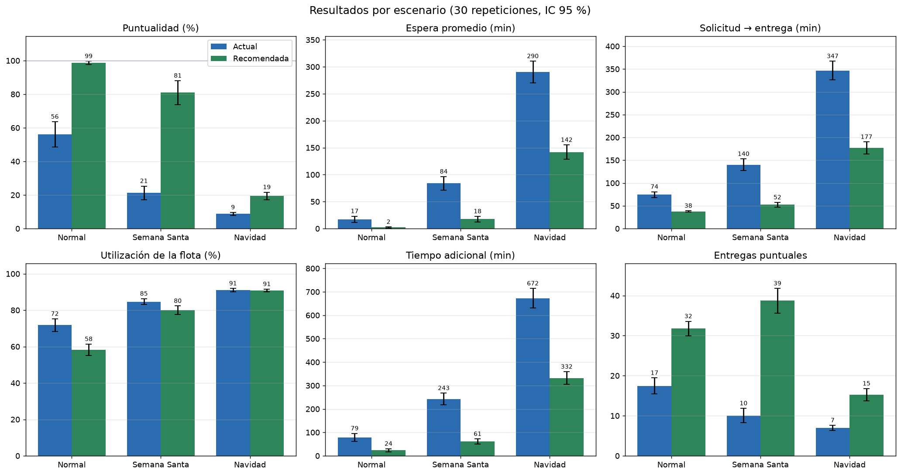
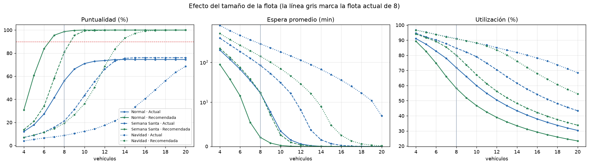
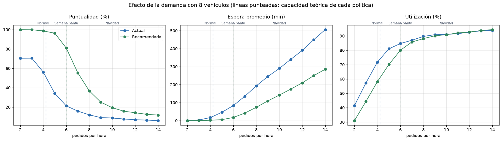
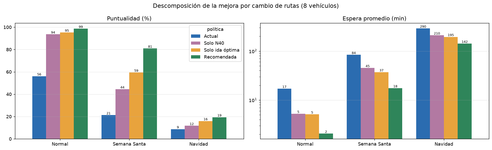
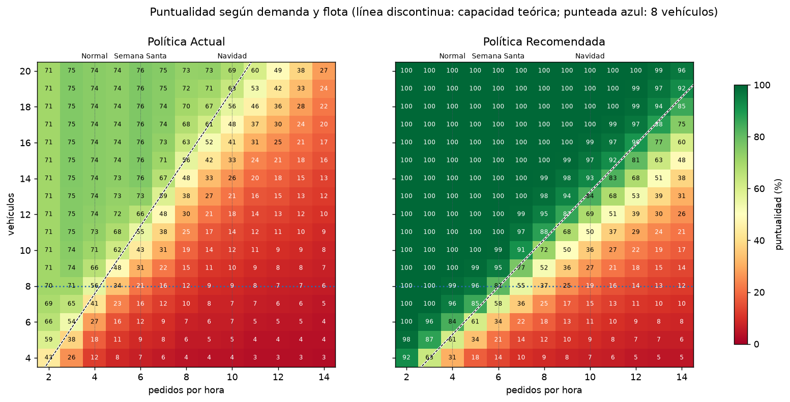
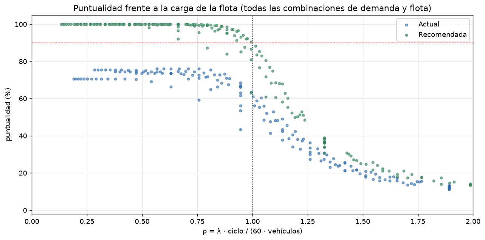

# Práctica 4 — Logística del Valle

CC2017 Modelación y Simulación · Universidad del Valle de Guatemala · Ciclo 2, 2026

Optimización de rutas y simulación de la operación de entregas desde la bodega **N01** hacia los destinos **N08, N19, N34 y N40**, a partir de la matriz de tiempos `Matriz_Logistica_del_Valle_40_nodos.csv`.

## Objetivo general

Desarrollar una aplicación que determine las rutas más convenientes de ida y regreso entre la bodega N01 y los cuatro destinos, y que simule la operación diaria de entregas, para evaluar si conviene cambiar las rutas actuales y si la flota de 8 vehículos es suficiente para cumplir entregas en 75 minutos o menos bajo distintos escenarios de demanda e incidentes viales.

## Objetivos específicos

1. Construir el grafo dirigido de la red a partir de la matriz de tiempos y validar si las rutas actuales son transitables tanto de ida como de regreso.
2. Implementar un algoritmo de búsqueda de rutas que obtenga, por separado, los caminos de ida y de regreso de menor tiempo, y compararlos con la ruta actual y al menos otra alternativa por destino.
3. Simular la llegada aleatoria de pedidos, la cola y el uso de los vehículos para comparar el desempeño de las rutas actuales contra las rutas propuestas, usando los mismos pedidos en ambos casos.
4. Evaluar la puntualidad, la espera y la utilización de la flota en los escenarios normal, Semana Santa y Navidad, para identificar a partir de qué demanda los 8 vehículos se vuelven una limitación.

## Algoritmos de búsqueda de rutas

### Características de la red que condicionan la elección

- **Grafo dirigido y ponderado:** 40 nodos y 144 arcos. Hay 18 calles de un solo sentido y 14 pares de puntos con tiempos distintos según el sentido, así que la ida y el regreso se calculan por separado.
- **Pesos positivos:** todos los tiempos están entre 4 y 11 minutos. No hay pesos negativos.
- **Sin coordenadas:** la matriz no trae ubicación de los puntos, así que no hay una distancia geométrica que sirva de heurística.
- **Red pequeña:** con 40 nodos cualquier algoritmo exacto responde en milisegundos. El criterio decisivo es la **exactitud** y que se pueda **recalcular al cambiar la red** (congestión o cierre de un tramo).

### Algoritmos elegidos

#### Dijkstra — rutas de menor tiempo

Algoritmo voraz que encuentra el camino de menor costo desde un origen hacia los demás nodos de un grafo con pesos no negativos (Dijkstra, 1959).

**Funcionamiento**

1. Asigna distancia 0 al origen e infinito al resto.
2. Toma de una cola de prioridad el nodo no visitado con menor distancia acumulada y lo marca como definitivo.
3. Para cada arco saliente `u → v` con peso `w`, si `d(u) + w < d(v)`, actualiza `d(v)` y guarda a `u` como predecesor de `v` (relajación).
4. Repite hasta llegar al destino. El camino se reconstruye siguiendo los predecesores.

**Por qué lo elegimos**

- Es **exacto**: con pesos no negativos garantiza el camino de menor tiempo.
- Respeta el **sentido de los arcos** sin ningún ajuste: solo recorre arcos salientes, así que `N01 → destino` y `destino → N01` dan rutas distintas cuando la red es asimétrica.
- Complejidad **O((V + E) log V)** con cola de prioridad (montículo binario). Para V = 40 y E = 144 es instantáneo.
- Ante un **incidente vial**, basta con modificar el peso del arco (congestión) o eliminarlo (cierre) y volver a ejecutarlo. Si el destino queda inalcanzable, lo detecta.

**Limitaciones**

- No admite pesos negativos (no aplica aquí).
- Solo devuelve **una** ruta: la óptima. Para el punto 4 necesitamos alternativas, y para eso usamos Yen.

#### Yen — k rutas más cortas sin ciclos

Genera, en orden de tiempo, las `k` mejores rutas simples (sin repetir nodos) entre dos puntos, usando Dijkstra como subrutina (Yen, 1971).

**Funcionamiento**

1. `A[0]` es la ruta óptima, obtenida con Dijkstra.
2. Para obtener `A[k]`, recorre cada nodo de `A[k-1]` como **nodo de desvío**:
   - La **raíz** es el tramo de `A[k-1]` desde el origen hasta el nodo de desvío.
   - Se eliminan temporalmente los arcos que salen del nodo de desvío y que ya usan las rutas encontradas con esa misma raíz, y también los nodos de la raíz (para evitar ciclos).
   - Con Dijkstra se calcula la **espuela**: el mejor camino desde el nodo de desvío hasta el destino en esa red reducida.
   - Raíz + espuela es una candidata y se guarda en una cola de prioridad.
3. `A[k]` es la candidata de menor tiempo. Se repite hasta tener `k` rutas o quedarse sin candidatas.

**Por qué lo elegimos**

- El punto 4 pide **al menos dos rutas alternativas válidas** por destino. Yen las entrega ordenadas por tiempo y garantiza que sean **distintas y sin ciclos**.
- Reutiliza la implementación de Dijkstra, así que no agrega un método independiente que haya que validar.
- Permite cuantificar **cuánto se pierde** si la ruta óptima no se puede usar (por ejemplo, la diferencia entre la 1.ª y la 2.ª ruta), lo cual sirve para el análisis de incidentes viales.

**Limitaciones**

- Complejidad **O(k · V · (V + E) log V)**, porque ejecuta Dijkstra una vez por cada nodo de desvío. Con 40 nodos y k pequeño sigue siendo inmediato.
- Las alternativas pueden diferir de la óptima en un solo tramo. Si se buscan rutas muy distintas, habría que penalizar los arcos ya usados.

### Otros algoritmos considerados

| Algoritmo | Idea | Ventajas en esta red | Limitaciones en esta red | Decisión |
|---|---|---|---|---|
| **A\*** (Hart et al., 1968) | Dijkstra guiado por una heurística `h(n)` que estima el costo restante | Explora menos nodos si `h` es informativa | No hay coordenadas para una heurística geométrica. Una opción admisible es `h(n)` = (mínimo de tramos de `n` al destino, por BFS) × 4 min (el arco más corto). Con `h = 0` se reduce exactamente a Dijkstra | Descartado: en 40 nodos no hay ganancia apreciable y la heurística añade complejidad |
| **Bellman-Ford** (Bellman, 1958) | Relaja todos los arcos V − 1 veces | Admite pesos negativos y detecta ciclos negativos | O(V · E), más lento, y sus ventajas no aplican porque todos los tiempos son positivos | Descartado |
| **Floyd-Warshall** (Floyd, 1962) | Programación dinámica que calcula los caminos más cortos entre todos los pares | Una sola ejecución da la tabla completa de ida y regreso | O(V³) en tiempo y O(V²) en memoria; calcula 1 560 pares cuando solo se necesitan 8 | Descartado; útil como verificación cruzada |
| **BFS** | Recorrido por niveles | Encuentra la ruta con menos tramos | Ignora los tiempos, así que no minimiza minutos | Solo como apoyo (heurística de A\*) |
| **Algoritmo genético** (Holland, 1975) | Metaheurística evolutiva: población de rutas, cruce y mutación | Útil en problemas NP-difíciles, como el ruteo con varias paradas | No garantiza el óptimo, depende de parámetros y es aleatorio. El camino más corto entre dos puntos tiene solución exacta en tiempo polinomial | Descartado: cada vehículo lleva un solo pedido, así que no hay un problema combinatorio que lo justifique |

## Roadmap

| Fase | Contenido | Punto del enunciado | Estado |
|---|---|---|---|
| 0 | Objetivos, datos, decisiones y supuestos | 1 | Objetivos ✅ |
| 1 | Grafo dirigido, visualización y validación de rutas actuales (`01_grafo.ipynb`) | 2 | ✅ |
| 2 | Investigación de algoritmos | 3 | ✅ |
| 3 | Implementación propia de Dijkstra y Yen (`src/rutas.py`, `02_rutas.ipynb`) | 3 | ✅ |
| 4 | Tabla comparativa por destino: actual vs. Dijkstra vs. alternativas de Yen (`02_rutas.ipynb`) | 4 | ✅ |
| 5 | Simulación de eventos discretos con dos políticas de rutas (`src/simulacion.py`, `03_simulacion.ipynb`) | 5 | ✅ |
| 6 | Aplicación configurable: escenarios, flota, semilla, incidentes viales (`app.py`) | 6 | ✅ |
| 7 | Experimentos: 30 repeticiones por escenario con números aleatorios comunes (`src/experimentos.py`, `04_experimentos.ipynb`) | 7 | ✅ |
| 8 | Análisis: aporte de las rutas, demanda, límite de la flota y robustez (`05_analisis.ipynb`) | 8 | ✅ |
| 9 | Informe final | Entrega | Pendiente |

## Modelo de simulación

Simulación de eventos discretos con [SimPy](https://simpy.readthedocs.io/) (`src/simulacion.py`).

- **Llegadas:** proceso de Poisson. Los tiempos entre pedidos son exponenciales con media 60/λ minutos (λ = 4 normal, 6 Semana Santa, 10 Navidad) y solo se reciben pedidos durante la jornada.
- **Destinos:** cada pedido va a N08, N19, N34 o N40 con probabilidad 1/4.
- **Flota:** 8 vehículos idénticos por defecto. Cada uno toma un pedido, hace la ida, entrega y regresa a N01 antes de tomar otro.
- **Cola:** FIFO cuando no hay vehículos libres.
- **Fin:** la simulación continúa después de la jornada hasta atender todos los pedidos recibidos.
- **Políticas:** *Actual* (hojas de despacho, regreso = ida invertida) y *Recomendada* (Dijkstra, ida y regreso por separado). Ambas se simulan con **los mismos pedidos** generados con la misma semilla.

### Supuestos

1. La tasa de llegadas es constante durante la jornada.
2. Los tiempos de viaje son deterministas e iguales a los de la matriz.
3. El tiempo de descarga en el destino es 0 min por defecto (configurable en la app).
4. Los vehículos no tienen averías, descansos ni turnos, y asignar un pedido no toma tiempo.
5. Una entrega es puntual si se completa en 75 min o menos desde la solicitud, incluida la espera.

### Métricas

Entregas puntuales, puntualidad, espera promedio y máxima, tiempo de la solicitud a la entrega, utilización de la flota (tiempo ocupado / (vehículos × duración total)) y tiempo adicional después del cierre de recepción hasta la última entrega.

## Aplicación

```bash
streamlit run app.py
```

- **Parámetros:** escenario (Normal, Semana Santa, Navidad o personalizado), pedidos por hora, número de vehículos, horas de recepción, semilla, tiempo de descarga y umbral de puntualidad.
- **Incidentes viales:** congestionar (nuevo tiempo) o cerrar uno o varios tramos.
- **Actualización de rutas:** cada incidente modifica una copia del grafo. La política recomendada vuelve a ejecutar Dijkstra sobre esa red, así que siempre usa la mejor ruta disponible. La política actual mantiene las rutas de las hojas de despacho con los tiempos nuevos; si una usa un tramo cerrado, ese viaje se reemplaza por la ruta de menor tiempo y la app lo avisa. Si un destino queda incomunicado, la app lo indica.
- **Resultados:** métricas de ambas políticas, cola y vehículos ocupados en el tiempo, distribución del tiempo de entrega, actividad de cada vehículo, rutas vigentes y red con los incidentes aplicados.

## Resultados de los experimentos

Detalle completo en `04_experimentos.ipynb`; tablas en CSV y figuras en `resultados/`.

### Diseño

- **3 escenarios** (Normal 4/h, Semana Santa 6/h, Navidad 10/h) × **30 repeticiones** (semillas 1–30; el enunciado pide al menos 5) × **2 políticas**, con 8 vehículos y 8 horas de recepción.
- **Números aleatorios comunes:** en cada semilla ambas políticas reciben exactamente los mismos pedidos, instantes de llegada y destinos.
- Se reporta la media con intervalo de confianza del 95 % (t de Student). Las políticas se comparan con la diferencia pareada por semilla y una prueba t pareada.

### Métricas por escenario y política

Media ± semiancho del IC 95 %, 30 repeticiones.

| Escenario | Política | Pedidos | Entregas puntuales | Puntualidad (%) | Espera promedio (min) | Solicitud → entrega (min) | Utilización (%) | Tiempo adicional (min) |
|---|---|---|---|---|---|---|---|---|
| Normal | Actual | 32.2 ± 1.9 | 17.4 ± 2.0 | 56.1 ± 7.5 | 17.1 ± 5.8 | 74.4 ± 6.3 | 71.8 ± 3.5 | 78.6 ± 16.9 |
| Normal | Recomendada | 32.2 ± 1.9 | **31.7 ± 1.8** | **98.7 ± 1.0** | **2.1 ± 1.0** | **37.6 ± 1.4** | 58.2 ± 3.2 | **23.5 ± 6.6** |
| Semana Santa | Actual | 48.7 ± 2.2 | 10.1 ± 1.8 | 21.2 ± 4.1 | 83.8 ± 12.5 | 140.2 ± 12.5 | 84.7 ± 1.6 | 242.9 ± 24.5 |
| Semana Santa | Recomendada | 48.7 ± 2.2 | **38.7 ± 3.1** | **81.0 ± 7.1** | **17.5 ± 5.1** | **52.4 ± 5.1** | 80.0 ± 2.3 | **61.4 ± 10.6** |
| Navidad | Actual | 80.0 ± 2.8 | 6.9 ± 0.7 | 8.7 ± 0.9 | 290.2 ± 20.2 | 346.7 ± 20.4 | 91.0 ± 0.9 | 672.4 ± 41.8 |
| Navidad | Recomendada | 80.0 ± 2.8 | **15.2 ± 1.6** | **19.4 ± 2.3** | **141.8 ± 13.3** | **176.7 ± 13.3** | 90.9 ± 0.7 | **331.7 ± 27.2** |



### Efecto de cambiar las rutas

Diferencia pareada Recomendada − Actual (media ± IC 95 %). Todas las diferencias son significativas (p < 0.001), salvo la utilización en Navidad (p = 0.63).

| Escenario | Entregas puntuales | Puntualidad (pp) | Espera promedio (min) | Solicitud → entrega (min) | Utilización (pp) | Tiempo adicional (min) |
|---|---|---|---|---|---|---|
| Normal | +14.3 ± 3.0 | +42.5 ± 7.2 | −15.0 ± 5.2 | −36.8 ± 5.7 | −13.6 ± 1.5 | −55.1 ± 13.9 |
| Semana Santa | +28.6 ± 3.0 | +59.7 ± 6.3 | −66.3 ± 8.4 | −87.8 ± 8.6 | −4.7 ± 1.5 | −181.6 ± 17.2 |
| Navidad | +8.3 ± 1.5 | +10.6 ± 2.0 | −148.4 ± 8.0 | −170.0 ± 8.4 | −0.2 ± 0.7 | −340.7 ± 18.2 |

### Puntualidad por destino

Porcentaje de pedidos puntuales de cada destino, sumando las 30 repeticiones.

| Escenario | Política | N08 | N19 | N34 | N40 |
|---|---|---|---|---|---|
| Normal | Actual | 72 % | 72 % | 74 % | **0 %** |
| Normal | Recomendada | 98 % | 100 % | 99 % | 98 % |
| Semana Santa | Actual | 23 % | 29 % | 29 % | **0 %** |
| Semana Santa | Recomendada | 68 % | 87 % | 88 % | 74 % |
| Navidad | Actual | 12 % | 12 % | 11 % | **0 %** |
| Navidad | Recomendada | 15 % | 24 % | 21 % | 16 % |

### Tamaño de la flota y demanda



Flota mínima para lograr, en promedio, el 90 % y el 95 % de entregas puntuales (barrido de 4 a 20 vehículos, 30 repeticiones cada uno):

| Escenario | Actual ≥ 90 % | Recomendada ≥ 90 % | Actual ≥ 95 % | Recomendada ≥ 95 % |
|---|---|---|---|---|
| Normal | nunca | **7** | nunca | **7** |
| Semana Santa | nunca | **9** | nunca | **9** |
| Navidad | nunca | **14** | nunca | **15** |

Con las rutas actuales la puntualidad no supera ~76 % aunque haya 20 vehículos, porque los pedidos a N40 (25 % del total) nunca llegan a tiempo.



Capacidad teórica de 8 vehículos (8 × 60 / ciclo promedio): **4.2 pedidos/h** con las rutas actuales (ciclo de 113.5 min) y **6.0 pedidos/h** con las recomendadas (79.5 min).

### Hallazgos principales

1. **Cambiar las rutas es la mejora más grande y no cuesta vehículos.** En un día normal la puntualidad sube de 56 % a 99 % y el tiempo de la solicitud a la entrega baja a la mitad (74 → 38 min). En Semana Santa sube de 21 % a 81 %.
2. **Las rutas actuales no alcanzan el 90 % con ninguna flota.** N40 tiene 0 % de puntualidad en todos los escenarios, porque su ida de 93 min ya supera el umbral de 75 min. Agregar vehículos no corrige un problema de ruta.
3. **La flota se vuelve la limitación cuando la demanda se acerca a la capacidad teórica.** Con las rutas actuales eso ya ocurre en un día normal (4 pedidos/h frente a una capacidad de 4.2). Con las recomendadas, la puntualidad se mantiene sobre 96 % hasta 5 pedidos/h y cae rápido después de 6 pedidos/h (81 % en Semana Santa, 55 % con 7 pedidos/h).
4. **En Navidad el problema es la flota.** Incluso con las rutas recomendadas solo 19 % de las entregas son puntuales y la operación termina unas 5.5 horas después del cierre de recepción. Para superar el 90 % hacen falta **14 vehículos** con rutas recomendadas.
5. **Menor utilización con las rutas recomendadas es una buena señal:** los vehículos quedan libres antes, así que hay holgura para absorber picos de demanda. En Navidad ambas políticas rondan el 91 %, lo que confirma que la flota está saturada.

## Análisis

Detalle en `05_analisis.ipynb`. Todos los experimentos usan 30 repeticiones con números aleatorios comunes.

### ¿Cuánto aporta cambiar las rutas?

Con 8 vehículos, la política recomendada reduce el tiempo de la solicitud a la entrega entre **49 % y 63 %** según el escenario, y sube la puntualidad 42.5 puntos en un día normal y 59.7 en Semana Santa.

Para saber de dónde viene la mejora, simulamos dos políticas intermedias con los mismos pedidos:

| Escenario | Actual | Solo corregir N40 | Solo ida óptima (regreso actual) | Recomendada (ida y regreso óptimos) |
|---|---|---|---|---|
| Normal | 56.1 % | 93.6 % | 95.3 % | **98.7 %** |
| Semana Santa | 21.2 % | 44.5 % | 59.5 % | **81.0 %** |
| Navidad | 8.7 % | 11.7 % | 15.9 % | **19.4 %** |



- **Con demanda baja**, casi toda la mejora viene de corregir N40, la única ruta que no puede cumplir el umbral.
- **Con demanda alta**, corregir solo N40 no basta: hay que acortar todos los ciclos para liberar vehículos.
- **Optimizar el regreso** agrega ~20 puntos en Semana Santa (59.5 % → 81 %), aunque el regreso no cuente en el tiempo de entrega: un vehículo que vuelve antes atiende antes al siguiente pedido.

**Equivalencia en vehículos:** para igualar la espera que logra la política recomendada con 8 vehículos, la actual necesitaría **11 vehículos** en Normal y Semana Santa y **12** en Navidad. Es decir, cambiar las rutas equivale a **3–4 vehículos más**. Aun con esa flota mayor, la política actual queda por debajo en puntualidad (73 % vs. 99 % en Normal), porque no corrige N40.

### ¿Qué sucede al aumentar la demanda?



- La puntualidad **no cae de forma gradual**: con flota fija se mantiene alta y se desploma en pocos pedidos/h cuando la demanda se acerca a la capacidad. Con 8 vehículos y rutas recomendadas: 99 % con 4 pedidos/h, 96 % con 5, 81 % con 6, 55 % con 7 y 37 % con 8.
- Con las rutas actuales el máximo es ~75 % aunque sobren vehículos.
- La frontera de buen servicio sigue la capacidad teórica (línea discontinua), pero algo por encima: hace falta una flota mayor que la teórica para absorber la variabilidad de las llegadas.

### ¿Cuándo la flota se vuelve una limitación?

La carga de la flota se resume en el factor de utilización teórico **ρ = λ · ciclo / (60 · k)** (λ pedidos/h, ciclo promedio ida + regreso, k vehículos).



| ρ (rutas recomendadas) | Puntualidad promedio |
|---|---|
| ≤ 0.9 | 97 – 100 % |
| 0.9 – 1.0 | ~90 % |
| 1.0 – 1.2 | ~69 % |
| 1.2 – 1.5 | ~37 % |
| > 1.5 | ~15 % |

**La flota es la limitación cuando ρ supera ~0.9.** Las flotas pequeñas necesitan más holgura (ρ ≈ 0.7–0.8 para llegar al 90 %) que las grandes (ρ ≈ 1), porque con más vehículos es más probable que alguno se libere pronto.

| Escenario (8 vehículos) | ρ con rutas actuales | ρ con rutas recomendadas | Diagnóstico |
|---|---|---|---|
| Normal (4/h) | 0.95 | 0.66 | Las rutas actuales ya saturan la flota; con las recomendadas hay holgura |
| Semana Santa (6/h) | 1.42 | 0.99 | Sin cambiar rutas la flota no alcanza; con las recomendadas queda en el límite |
| Navidad (10/h) | 2.36 | 1.66 | La flota es la limitación con cualquier ruta: hacen falta ~14 vehículos |

### Robustez

**Tiempo de descarga.** La política recomendada gana con cualquier valor, pero la conclusión sobre Semana Santa depende de este supuesto:

| Puntualidad con rutas recomendadas | 0 min | 5 min | 10 min | 15 min |
|---|---|---|---|---|
| Normal | 98.7 % | 97.0 % | 94.1 % | 90.0 % |
| Semana Santa | 81.0 % | 68.1 % | 54.1 % | 42.0 % |
| Navidad | 19.4 % | 16.1 % | 14.0 % | 12.2 % |

**Incidente vial.** Congestionando N09 → N01 (el tramo más crítico) de 7 a 30 min, **recalcular las rutas** con Dijkstra sube la puntualidad de Semana Santa de 49 % (rutas recomendadas sin recalcular) a 69 %. La política actual queda en 19 %.

### Lo que la simulación no representa

- **Tráfico variable y horas pico:** los tiempos de viaje y la tasa de pedidos son constantes; en la realidad habría más retrasos y colas concentradas en ciertas horas.
- **Carga y descarga:** se suponen instantáneas; la sensibilidad anterior muestra que importan en temporada alta.
- **Varios pedidos por viaje:** cada vehículo lleva uno solo. Agrupar pedidos del mismo destino podría aumentar mucho la capacidad en temporada alta.
- **Prioridades:** la cola es FIFO estricta, sin pedidos urgentes.
- **Flota ideal:** sin averías, descansos, turnos ni límites de jornada; la operación sigue hasta terminar, aunque implique horas extra.
- **Demanda:** destinos equiprobables y llegadas de Poisson sin tendencias ni días atípicos.
- **Cumplimiento y datos:** se asume que los conductores siguen la ruta asignada y que la matriz de tiempos es exacta y vigente.
- **Costos:** no se modelan combustible, salarios ni penalizaciones; el análisis dice qué es más rápido, no qué es más rentable.

### Conclusiones

1. **Cambiar las rutas es la decisión de mayor impacto y menor costo:** en un día normal la puntualidad pasa de 56 % a 99 %, y el efecto equivale a 3–4 vehículos adicionales.
2. **La mejora tiene dos mecanismos:** con demanda baja, corregir N40; con demanda alta, acortar todos los ciclos, incluido el regreso.
3. **La flota se vuelve la limitación cuando ρ supera ~0.9.** Con rutas recomendadas y 8 vehículos esto ocurre desde ~6 pedidos/h: Semana Santa queda en el límite y Navidad necesita alrededor de 14 vehículos.
4. **La dirección de las conclusiones es robusta** (la política recomendada siempre gana), pero el tamaño de flota para temporadas altas depende de supuestos que conviene medir en la operación real, en especial el tiempo de descarga.

## Cómo ejecutar

```bash
python -m venv .venv
.venv\Scripts\activate
pip install -r requirements.txt
jupyter notebook          # notebooks 01 a 05
streamlit run app.py      # aplicación
```

## Archivos

- `Práctica_4.pdf` — enunciado de la práctica.
- `Matriz_Logistica_del_Valle_40_nodos.csv` — matriz de adyacencia (minutos de viaje; celda vacía = sin conexión directa).
- `src/grafo.py` — carga de la matriz, construcción del grafo dirigido, dibujo y validación de rutas.
- `src/rutas.py` — implementación propia de Dijkstra y Yen, rutas óptimas de ida y regreso, e incidentes viales (congestión o cierre de un tramo).
- `src/simulacion.py` — generación de pedidos, simulación de eventos discretos y métricas.
- `src/graficas.py` — gráficas de la simulación (cola, uso de la flota, tiempos de entrega, actividad por vehículo).
- `src/experimentos.py` — repeticiones, intervalos de confianza, diferencias pareadas, políticas mixtas y barridos de flota y demanda.
- `app.py` — aplicación configurable en Streamlit.
- `01_grafo.ipynb` — construcción del grafo, red completa, validación de las rutas actuales y comparación de ida y regreso por destino.
- `02_rutas.ipynb` — selección del algoritmo, implementación y verificación de Dijkstra y Yen, tabla comparativa de rutas por destino y efecto de incidentes viales.
- `03_simulacion.ipynb` — descripción del modelo, validación del generador de pedidos, corrida de ejemplo y comparación de escenarios.
- `04_experimentos.ipynb` — 30 repeticiones por escenario, comparación pareada de políticas, puntualidad por destino y barridos de flota y demanda.
- `05_analisis.ipynb` — descomposición de la mejora, equivalencia en vehículos, mapa demanda × flota, factor de utilización, sensibilidad e incidentes.
- `resultados/` — tablas (CSV) y figuras de los experimentos y del análisis.
- `requirements.txt` — dependencias de Python.

## Referencias

Bellman, R. (1958). On a routing problem. *Quarterly of Applied Mathematics, 16*(1), 87–90. https://doi.org/10.1090/qam/102435

Cormen, T. H., Leiserson, C. E., Rivest, R. L., & Stein, C. (2022). *Introduction to algorithms* (4th ed.). MIT Press.

Dijkstra, E. W. (1959). A note on two problems in connexion with graphs. *Numerische Mathematik, 1*(1), 269–271. https://doi.org/10.1007/BF01386390

Floyd, R. W. (1962). Algorithm 97: Shortest path. *Communications of the ACM, 5*(6), 345. https://doi.org/10.1145/367766.368168

Hart, P. E., Nilsson, N. J., & Raphael, B. (1968). A formal basis for the heuristic determination of minimum cost paths. *IEEE Transactions on Systems Science and Cybernetics, 4*(2), 100–107. https://doi.org/10.1109/TSSC.1968.300136

Holland, J. H. (1975). *Adaptation in natural and artificial systems*. University of Michigan Press.

Law, A. M. (2015). *Simulation modeling and analysis* (5th ed.). McGraw-Hill Education.

Team SimPy. (2024). *SimPy: Discrete event simulation for Python* (Version 4.1) [Software]. https://simpy.readthedocs.io/

Yen, J. Y. (1971). Finding the K shortest loopless paths in a network. *Management Science, 17*(11), 712–716. https://doi.org/10.1287/mnsc.17.11.712
